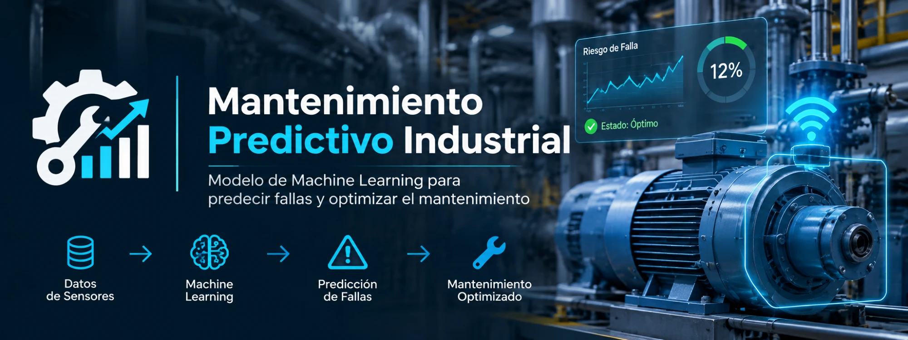

<p align="center">
  
</p>

# MaintenanceML-ProductionPipeline

Proyecto *end-to-end* de **Machine Learning para mantenimiento predictivo industrial**. A partir de las lecturas de los sensores de una máquina de fresado, el sistema predice si la máquina va a fallar, para poder programar el mantenimiento **antes** de que ocurra la avería y evitar paradas no planificadas.

El proyecto cubre todo el flujo: comprensión del negocio, análisis y limpieza de datos, modelado, optimización y **despliegue** como una API con interfaz web.

---

## 🎯 Problema de negocio

Una parada inesperada de una máquina detiene la producción y es más cara que un mantenimiento preventivo. El objetivo es **anticipar los fallos** a partir de variables del proceso (temperatura, velocidad, torque, desgaste), priorizando **detectar los fallos reales** (recall) aunque eso suponga alguna falsa alarma.

## 📊 Dataset

[AI4I 2020 Predictive Maintenance Dataset](https://archive.ics.uci.edu/dataset/601/ai4i+2020+predictive+maintenance+dataset) — 10.000 registros sintéticos de una máquina de fresado.

- **Variables de entrada:** `Type` (calidad L/M/H), `Air temperature [K]`, `Process temperature [K]`, `Rotational speed [rpm]`, `Torque [Nm]`, `Tool wear [min]`.
- **Objetivo:** `Machine failure` (1 = falla, 0 = no falla).
- Tras la limpieza (eliminación de identificadores, columnas con fuga de datos y fallos aleatorios): **9.981 registros**, con un fuerte desbalanceo (**solo 3,39 % de fallos**).

## 🧠 Modelado y resultados

Se compararon 7 modelos con validación cruzada estratificada y se optimizaron los mejores con `RandomizedSearchCV`, usando **PR-AUC** como métrica principal por el desbalanceo de clases.

**Modelo final: LightGBM** con el umbral de decisión ajustado (0,155 en lugar de 0,5) para priorizar el recall.

| Métrica (test) | Valor |
|---|---|
| PR-AUC | 0,866 |
| ROC-AUC | 0,971 |
| **Recall** | **0,90** |
| Precision | 0,60 |
| F1 | 0,72 |

> Con el umbral ajustado, el modelo detecta **61 de 68 fallos reales** del conjunto de test, a cambio de algunas falsas alarmas (mantenimientos preventivos de más), un coste asumible frente al de una parada no planificada.

## 🚀 Despliegue

Una API en **Flask** carga el pipeline entrenado (`models/modelo_mantenimiento.joblib`) y ofrece:

- **Interfaz web** (`/`): formulario para introducir las lecturas de una máquina y obtener la predicción.
- **API JSON** (`POST /api/predict`): para integrar con otros sistemas.
- **Health check** (`/health`).

### Ejemplo de uso de la API

```bash
curl -X POST http://localhost:5000/api/predict \
  -H "Content-Type: application/json" \
  -d '{"Type":"L","Air temperature [K]":302,"Process temperature [K]":311.5,"Rotational speed [rpm]":1300,"Torque [Nm]":65,"Tool wear [min]":220}'
```

```json
{"prediccion": 1, "etiqueta": "Fallo probable", "probabilidad_fallo": 0.9997, "umbral": 0.1547}
```

---

## 📁 Estructura del proyecto

```
MaintenanceML-ProductionPipeline/
├── data/                  # Dataset original y limpio
├── notebooks/             # Fases 1 a 7 del proyecto (CRISP-DM)
│   ├── Fase_01_Business_Case_&_Data_Collection.ipynb
│   ├── Fase_02_Data_Understanding.ipynb
│   ├── Fase_03_Data_Cleaning.ipynb
│   ├── Fase_04_Analysis.ipynb
│   ├── Fase_05_Resultados.ipynb
│   ├── Fase_06_Modelado.ipynb
│   └── Fase_07_Optimizacion.ipynb
├── models/                # Modelo entrenado (.joblib) y metadatos (.json)
├── app.py                 # API Flask
├── templates/             # Frontend (formulario web)
├── static/                # Estilos
├── Procfile               # Arranque en producción (gunicorn)
├── requirements.txt       # Dependencias para notebooks y desarrollo
└── requirements-deploy.txt# Dependencias mínimas para servir el modelo
```

## ⚙️ Cómo ejecutarlo

**1. Clonar e instalar dependencias**

```bash
git clone https://github.com/MHHsim/MaintenanceML-ProductionPipeline.git
cd MaintenanceML-ProductionPipeline
pip install -r requirements.txt
```

**2. Ejecutar los notebooks** (opcional, para reproducir el análisis y el modelado)

```bash
jupyter notebook
```

**3. Levantar la aplicación**

```bash
# Desarrollo
python app.py
# Producción
gunicorn app:app
```

Abre `http://localhost:5000` en el navegador.

> **Reproducibilidad:** el modelo guardado debe cargarse con las versiones de librerías registradas en `models/modelo_mantenimiento_metadata.json` (en especial, la misma versión de scikit-learn).

---

## 👥 Autoras

- **Marta Harana** — análisis exploratorio, limpieza y modelado
- **Claudia Franzoni** — optimización del modelo, métrica y despliegue
